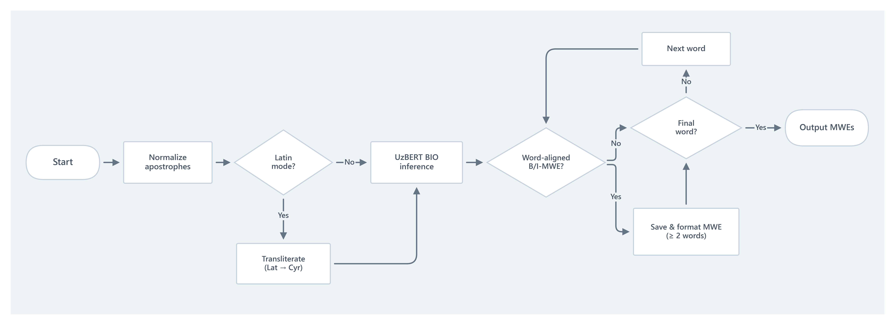

# Uzbek MWE Tokenizer (`uzbek-mwe-tokenizer`)

[](https://pypi.org/project/uzbek-mwe-tokenizer/)
[](https://github.com/MaksudSharipov/uzbek-mwe-tokenizer/actions/workflows/python-tests.yml)
[](https://pepy.tech/project/uzbek-mwe-tokenizer)
[](https://github.com/MaksudSharipov/uzbek-mwe-tokenizer/blob/main/LICENSE)
[](https://www.python.org/)
[](https://huggingface.co/MaksudSharipov/Uzbek-MWE-Tokenizer-uzBERT)

**`uzbek-mwe-tokenizer`** (`UzbekMWETokenizer`) is an open-source Python library for Transformer-based Multi-Word Expression (MWE) identification in Uzbek language texts. It is built on a fine-tuned **UzBERT** model (`MaksudSharipov/Uzbek-MWE-Tokenizer-uzBERT`) and extracts idiomatic expressions, auxiliary verb constructions, compound verbs, and compound nouns in context.

- **Current software version:** `v0.1.1`
- **Previous PyPI release:** `v0.1.0`
- **Python compatibility:** `Python >= 3.8`
- **PyPI package:** [uzbek-mwe-tokenizer](https://pypi.org/project/uzbek-mwe-tokenizer/)
- **GitHub repository:** [MaksudSharipov/uzbek-mwe-tokenizer](https://github.com/MaksudSharipov/uzbek-mwe-tokenizer)
- **Hugging Face model:** [MaksudSharipov/Uzbek-MWE-Tokenizer-uzBERT](https://huggingface.co/MaksudSharipov/Uzbek-MWE-Tokenizer-uzBERT)
- **License:** MIT License



## Main Features

- Transformer-based MWE identification (`B-MWE`, `I-MWE`, `O`) for Uzbek texts.
- Fine-tuned 108.5M-parameter `UzBERT` model for contextual MWE boundary prediction.
- Cross-script support for both Latin (`mode="lot"`) and Cyrillic (`mode="cyr"`) Uzbek alphabets.
- Smart Unicode apostrophe standardization (`’`, `‘`, ````, `´`, `ʼ`, `ʻ` $\rightarrow$ `'`), punctuation-decoupled lexical pre-tokenization, and monographemic Cyrillic projection to prevent subword fragmentation.
- Subword-to-word alignment via `word_ids()`, safe sequence truncation (`max_length=512`), and phrase-level Softmax confidence scoring (`round(avg_score, 2)`).
- Public distribution through PyPI (1,411+ cumulative downloads; 207 in the last 30 days) and Hugging Face Hub (146+ all-time model downloads; 18 in the last 30 days).

## Installation

Install the package from PyPI (`Python >= 3.8`):

```bash
pip install uzbek-mwe-tokenizer
```

For development installation from GitHub:

```bash
git clone https://github.com/MaksudSharipov/uzbek-mwe-tokenizer.git
cd uzbek-mwe-tokenizer
pip install -r requirements.txt
pip install -e .
```

## Quick Start

### 1. Latin Mode (`mode="lot"`)

The package automatically standardizes apostrophes, projects Latin text to Cyrillic for monographemic inference, and restores extracted MWEs back to Latin:

```python
from uzbek_mwe_tokenizer import UzbekMWETokenizer

tokenizer_lot = UzbekMWETokenizer(mode="lot")
text_lat = "Natijani ko'rib, hamma o'quvchilarning birdaniga tarvuzi qo'ltig'idan tushdi."
print(tokenizer_lot.extract_mwe(text_lat))
```

Output:

```text
[{'mwe': "tarvuzi qo'ltig'idan tushdi", 'confidence': 99.98}]
```

### 2. Cyrillic Mode (`mode="cyr"`)

```python
from uzbek_mwe_tokenizer import UzbekMWETokenizer

tokenizer_cyr = UzbekMWETokenizer(mode="cyr")
text_cyr = "Қоронғи хонада унинг қаттиқ капалаги учди, гўё ерга кирса, қулоғидан тортиб чиқарадиган ҳолат эди."
print(tokenizer_cyr.extract_mwe(text_cyr))
```

Output:

```text
[
    {'mwe': 'капалаги учди', 'confidence': 99.99},
    {'mwe': 'ерга кирса', 'confidence': 76.42},
    {'mwe': 'қулоғидан тортиб чиқарадиган', 'confidence': 98.08}
]
```

## Model Performance (`benchmark/`)

Evaluated on an isomorphic Latin–Cyrillic Uzbek MWE corpus (**11,936 sentences, 108,200 tokens, and 14,285 MWEs**):

| Model Architecture | Script | Accuracy | Precision | Recall | F1-Score |
|---|---|---:|---:|---:|---:|
| BERTbek-News | Latin | 0.9602 | 0.8632 | 0.9011 | 0.8817 |
| UzRoBERTa-v2 | Latin | 0.9582 | 0.8659 | 0.8947 | 0.8801 |
| mBERT-Cased | Latin | 0.9531 | 0.8619 | 0.8954 | 0.8783 |
| XLM-RoBERTa | Latin | 0.9568 | 0.8591 | 0.8919 | 0.8752 |
| **UzBERT-Uncased (`uzbek-mwe-tokenizer`)** | **Cyrillic** | **0.9559** | **0.8528** | **0.8926** | **0.8722** |
| Tahrirchi-BERT | Latin | 0.9541 | 0.8597 | 0.8834 | 0.8714 |

## Testing & Benchmarking

Run the unit and integration test suite with `pytest`:

```bash
pytest tests -v
```

Run evaluation and inference-speed benchmarks:

```bash
python benchmark/evaluate.py --test-file path/to/test.conll --output benchmark/eval_summary.csv
python benchmark/speed_test.py
```

## Repository Structure

```text
uzbek-mwe-tokenizer/
├── README.md
├── LICENSE
├── CITATION.cff
├── RELEASE_NOTES_v0.1.1.md
├── pyproject.toml
├── setup.py
├── requirements.txt
├── test_examples.py
├── uzbek_mwe_tokenizer/
│   ├── __init__.py
│   └── tokenizer.py
├── examples/
│   ├── basic_usage.py
│   └── batch_extraction.py
├── tests/
│   ├── test_tokenizer.py
│   ├── test_import.py
│   └── test_model_integration_optional.py
├── benchmark/
│   ├── evaluate.py
│   ├── speed_test.py
│   ├── results.csv
│   └── README.md
├── docs/
│   ├── figure1_mwe_algorithm.png
│   ├── installation.md
│   ├── usage.md
│   └── tagset.md
└── paper/
    └── SOFTWARE_IMPACTS_MANUSCRIPT.md
```

## Citation

If you use this software or model in your research or project, please cite both the software package and the foundational MWE study:

```bibtex
@software{sharipov2026uzbekmwetokenizer,
  title   = {UzbekMWETokenizer: A Python library for Transformer-based multi-word expression identification in Uzbek},
  author  = {Sharipov, Maksud and Saidov, Abdusobir and Ruzmetov, Azizbek and Bekchanov, Shukurla and Sobirov, Ogabek and Sattarova, Surayyo},
  year    = {2026},
  version = {0.1.1},
  license = {MIT},
  url     = {https://github.com/MaksudSharipov/uzbek-mwe-tokenizer}
}

@article{sharipov2026mwe,
  title   = {Transformer-based intelligent model for identifying multi-word lexical units and reducing syntactic ambiguities in Uzbek language texts},
  author  = {Sharipov, Maksud S.},
  journal = {Bulletin of TUIT: Management and Communication Technologies},
  volume  = {2},
  number  = {14},
  pages   = {103--107},
  year    = {2026},
  doi     = {10.61663/262tuitmct14}
}
```

## Authors

- **Maksud Sharipov** (Corresponding Author — Urgench State University & Tashkent University of Information Technologies; [ORCID](https://orcid.org/0000-0002-2363-6533))
- **Abdusobir Saidov** (Tashkent University of Information Technologies)
- **Azizbek Ruzmetov** (Kimyo International University in Tashkent)
- **Shukurla Bekchanov** (Mamun University)
- **Ogabek Sobirov** (Tashkent State University of Economics; [ORCID](https://orcid.org/0000-0003-1770-8550))
- **Surayyo Sattarova** (RANCH University of Technology)

## License

This project is licensed under the MIT License. See the [LICENSE](LICENSE) file for details.
