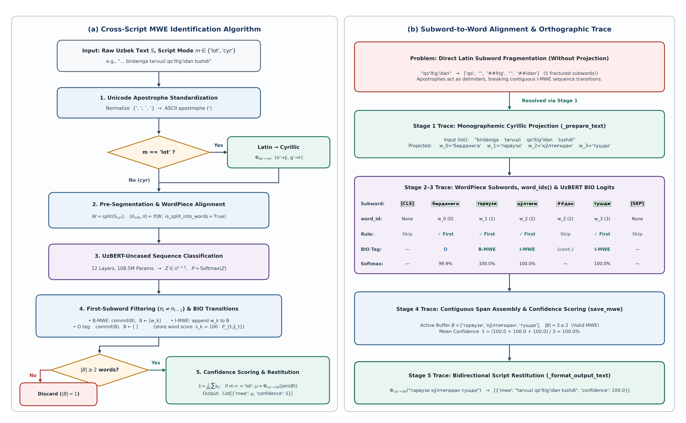

# UzbekMWETokenizer: A Python library for Transformer-based multi-word expression identification in Uzbek

**Maksud Sharipov** $^{a,b,*}$  
$^{a}$ *Department of Convergence of Digital Technologies, Tashkent University of Information Technologies named after Muhammad al-Khwarizmi, Urgench Branch, Urgench 220100, Uzbekistan*  
$^{b}$ *Department of Computer Science and Artificial Intelligence Technologies, Urgench State University named after Abu Rayhan Biruni, Urgench 220100, Uzbekistan*  
$^{*}$ *Corresponding author. E-mail address:* `maqsbek72@gmail.com` | *ORCID:* [https://orcid.org/0000-0002-2363-6533](https://orcid.org/0000-0002-2363-6533)

---

## Abstract
`uzbek-mwe-tokenizer` (`UzbekMWETokenizer`) is an open-source Python library for identifying and extracting multi-word expressions (MWEs) in Uzbek texts using a fine-tuned UzBERT transformer model. In agglutinative Uzbek, MWEs such as idioms, compound verbs, and auxiliary verb constructions create syntactic ambiguities, while Latin apostrophe modifiers cause severe subword fragmentation. The package standardizes apostrophe variants, applies bidirectional Latin–Cyrillic script projection for monographemic inference, aligns subword predictions to full words, and filters contiguous multi-token phrases ($\ge 2$ words) with confidence scores. Validated on 11,936 sentences (14,285 MWEs), it achieves 0.9559 accuracy and 0.8722 F1-score without boundary loss, supporting downstream parsing, lemmatization, and machine translation.

## Keywords
Multi-word expressions; Uzbek NLP; Tokenization; Transformer; UzBERT; Syntactic disambiguation

---

## Code metadata

| Nr | Code metadata description | Metadata |
| :--- | :--- | :--- |
| C1 | Current code version | v0.1.0 |
| C2 | Permanent link to code/repository used for this code version | https://github.com/MaksudSharipov/uzbek-mwe-tokenizer |
| C3 | Permanent link to reproducible capsule | Not applicable |
| C4 | Legal code license | MIT License |
| C5 | Code versioning system used | git |
| C6 | Software code languages, tools and services used | Python, PyTorch, Hugging Face Transformers, SentencePiece, UzTransliterator |
| C7 | Compilation requirements, operating environments and dependencies | OS-independent (Linux, macOS, Windows); Python >= 3.8; dependencies: torch, transformers, UzTransliterator, sentencepiece |
| C8 | If available, link to developer documentation/manual | https://github.com/MaksudSharipov/uzbek-mwe-tokenizer/blob/main/README.md |
| C9 | Support email for questions | maqsbek72@gmail.com |

---

## 1. High-level functionality and purpose of the software

In natural language processing (NLP) for strongly agglutinative Turkic languages such as Uzbek, accurate syntactic and semantic analysis relies heavily on how lexical boundaries are defined during initial tokenization [1–4]. Multi-word expressions (MWEs)—lexical combinations exhibiting idiosyncratic semantics or syntax [5, 6]—occur at high density in Uzbek texts, including auxiliary verb constructions (*sotib olmoq* [to buy]), nominal-verbal compound predicates (*qaror qilmoq* [to decide]), open compound nouns [7], and idiomatic expressions (*tarvuzi qo‘ltig‘idan tushdi* [to lose hope]). Although written as multiple space-separated words, an MWE functions as a single semantic and syntactic unit [8]. Traditional word-level tokenizers split MWEs into isolated tokens, causing erroneous dependency parse trees, inaccurate part-of-speech (POS) and lemma assignments [1–4, 7], and literal mistranslations in neural machine translation.

A second practical obstacle in Uzbek computational linguistics is the concurrent use of Latin and Cyrillic scripts. In the Uzbek Latin alphabet, letters such as *o‘*, *g‘*, and the glottal stop (*’*) rely on apostrophe-like modifiers (`’`, `‘`, `'`, ````, `ʻ`). Standard subword tokenizers (WordPiece and Byte-Pair Encoding) underlying pretrained Transformer models [9, 10] treat these apostrophes as punctuation boundaries, splitting a single inflected word (e.g., *qo‘ltig‘idan*) into fragmented subwords (`qo` + `'` + `ltig` + `'` + `idan`) and disrupting `I-MWE` (Inside) sequence labels [8].

`uzbek-mwe-tokenizer` (`UzbekMWETokenizer`) is an open-source Python software library distributed via PyPI (`https://pypi.org/project/uzbek-mwe-tokenizer/`) that resolves both syntactic MWE ambiguity and Latin apostrophe subword fragmentation. It encapsulates a fine-tuned 108.5M-parameter `UzBERT-Uncased` token classification model hosted on the Hugging Face Hub (`MaksudSharipov/Uzbek-MWE-Tokenizer-uzBERT`) [11, 12] within a deterministic three-stage cross-script pipeline:

- **Apostrophe Normalization and Monographemic Projection (`_prepare_text`):** Standardizes heterogeneous Unicode apostrophes (`’`, `‘`, ````, `ʻ`) to ASCII (`'`) and, when initialized in Latin mode (`mode="lot"`), projects input text into monographemic Cyrillic (`o‘` $\rightarrow$ `ў`, `g‘` $\rightarrow$ `ғ`, `sh` $\rightarrow$ `ш`, `ch` $\rightarrow$ `ч`) via `UzTransliterator` [13].
- **Subword-Aligned BIO Sequence Inference (`extract_mwe`):** Tokenizes pre-segmented words with `is_split_into_words=True`, computes contextual Softmax probabilities over `{0: O, 1: B-MWE, 2: I-MWE}`, and uses `inputs.word_ids()` to align first-subword predictions back to complete orthographic words.
- **Contiguous Phrase Filtering and Script Restitution (`save_mwe`, `_format_output_text`):** Aggregates contiguous `B-MWE` and `I-MWE` tokens, retains valid multi-word spans ($\ge 2$ words), computes arithmetic mean confidence scores ($0$–$100\%$), and restores extracted spans to Latin script when `mode="lot"`.

Figure 1 illustrates the end-to-end algorithmic control flow alongside a concrete subword-to-word alignment trace demonstrating how monographemic projection prevents Latin apostrophe splitting, while Algorithm 1 formalizes the exact extraction procedure.



*Algorithm 1: Cross-Script Subword-Aligned MWE Identification (`UzbekMWETokenizer`)*
> **Input:** Raw Uzbek text $S$; script mode $m \in \{\texttt{"lot"}, \texttt{"cyr"}\}$; fine-tuned Transformer $\mathcal{M}_{\theta}$ (`UzBERT-Uncased`); WordPiece tokenizer $\mathcal{T}$; bidirectional transliterator $\Phi_{\text{lat}\leftrightarrow\text{cyr}}$.  
> **Output:** Extracted MWE list $\mathcal{E} = \big[\{\texttt{"mwe"}: \mu_r,\; \texttt{"confidence"}: \bar{s}_r\}\big]_{r=1}^{R}$.  
> 1. **if** $\text{trim}(S) = \varnothing$ **then return** $[\,]$  
> 2. $S_{\text{norm}} \leftarrow \text{Replace}\big(S,\; \{\text{’}, \text{‘}, \text{`}, \text{ʻ}\} \mapsto \text{'}\big)$ $\quad\triangleright$ *Unicode apostrophe standardization*  
> 3. $S_{\text{cyr}} \leftarrow \Phi_{\text{lat}\to\text{cyr}}(S_{\text{norm}})$ **if** $m = \texttt{"lot"}$ **else** $S_{\text{norm}}$ $\quad\triangleright$ *Monographemic Cyrillic projection*  
> 4. $W = (w_0, w_1, \dots, w_{K-1}) \leftarrow \text{SplitWhitespace}(S_{\text{cyr}})$  
> 5. $(X_{\text{sub}}, \pi) \leftarrow \mathcal{T}(W,\; \texttt{is\_split\_into\_words}=\texttt{True})$, where $\pi = (\pi_0, \dots, \pi_{L-1})$  
> 6. $Z \leftarrow \mathcal{M}_{\theta}(X_{\text{sub}}) \in \mathbb{R}^{L \times 3}$; $\quad P_{t,c} \leftarrow \dfrac{\exp(Z_{t,c})}{\sum_{c'=0}^{2}\exp(Z_{t,c'})}$ for $t = 0, \dots, L-1$  
> 7. Initialize $\mathcal{E} \leftarrow [\,]$, word buffer $B \leftarrow [\,]$, score buffer $C \leftarrow [\,]$, $\pi_{\text{prev}} \leftarrow \varnothing$  
> 8. **Procedure** $\textsc{CommitSpan}(B, C)$:  
> $\quad$ **if** $|B| \ge 2$ **then**  
> $\qquad$ $\bar{s} \leftarrow \frac{1}{|B|} \sum_{s \in C} s$; $\quad \mu \leftarrow \Phi_{\text{cyr}\to\text{lat}}(\text{Join}(B))$ **if** $m = \texttt{"lot"}$ **else** $\text{Join}(B)$  
> $\qquad$ Append $\{\texttt{"mwe"}: \mu,\; \texttt{"confidence"}: \bar{s}\}$ to $\mathcal{E}$  
> 9. **for** $t = 0$ **to** $L - 1$ **do**  
> $\quad$ **if** $\pi_t \neq \varnothing$ **and** $\pi_t \neq \pi_{\text{prev}}$ **then** $\quad\triangleright$ *Evaluate strictly at first subword of word $w_{\pi_t}$*  
> $\qquad$ $\hat{y}_t \leftarrow \arg\max_{c \in \{0,1,2\}} Z_{t,c}$; $\quad s_t \leftarrow 100 \cdot P_{t,\hat{y}_t}$; $\quad u \leftarrow w_{\pi_t}$  
> $\qquad$ **if** $\text{Label}(\hat{y}_t) = \texttt{"B-MWE"}$ **then** $\textsc{CommitSpan}(B, C)$; $B \leftarrow [u]$; $C \leftarrow [s_t]$  
> $\qquad$ **else if** $\text{Label}(\hat{y}_t) = \texttt{"I-MWE"}$ **then** append $u$ to $B$; append $s_t$ to $C$  
> $\qquad$ **else** ($\texttt{"O"}$): $\textsc{CommitSpan}(B, C)$; $B \leftarrow [\,]$; $C \leftarrow [\,]$  
> $\quad$ $\pi_{\text{prev}} \leftarrow \pi_t$  
> 10. $\textsc{CommitSpan}(B, C)$; **return** $\mathcal{E}$

The package installs via `pip install uzbek-mwe-tokenizer` and provides a unified API for both scripts (Listing 1).

*Listing 1: Bilingual Python API usage of UzbekMWETokenizer in Latin and Cyrillic modes.*
```python
from uzbek_mwe_tokenizer import UzbekMWETokenizer

# 1. Latin mode (automatic apostrophe normalization + Cyrillic inference + Latin restitution)
tokenizer_lot = UzbekMWETokenizer(mode="lot")
text_lat = "Natijani ko'rib, hamma o'quvchilarning birdaniga tarvuzi qo'ltig'idan tushdi."
print(tokenizer_lot.extract_mwe(text_lat))
# Output: [{'mwe': "tarvuzi qo'ltig'idan tushdi", 'confidence': 100.0}]

# 2. Native Cyrillic mode
tokenizer_cyr = UzbekMWETokenizer(mode="cyr")
text_cyr = "Қоронғи хонада унинг қаттиқ капалаги учди, гўё ерга кирса, қулоғидан тортиб чиқарадиган ҳолат эди."
print(tokenizer_cyr.extract_mwe(text_cyr))
# Output: [{'mwe': 'капалаги учди', 'confidence': 100.0},
#          {'mwe': 'ерга кирса', 'confidence': 76.0},
#          {'mwe': 'қулоғидан тортиб чиқарадиган', 'confidence': 99.0}]
```

---

## 2. Impact overview and achieved results

### 2.1. Empirical validation and advancement of existing research questions
The sequence labeling model integrated into `uzbek-mwe-tokenizer` was trained and evaluated on a parallel, isomorphic Latin–Cyrillic Uzbek MWE corpus comprising 11,936 sentences, 108,200 tokens, and 14,285 annotated MWEs across six Transformer architectures (Table 1) [8].

*Table 1: Comparative evaluation of six Transformer architectures on the Uzbek MWE test set [8].*

| Model Architecture | Script | Accuracy | Precision | Recall | F1-Score |
| :--- | :--- | :---: | :---: | :---: | :---: |
| BERTbek-News | Latin | 0.9602 | 0.8632 | 0.9011 | 0.8817 |
| UzRoBERTa-v2 | Latin | 0.9582 | 0.8659 | 0.8947 | 0.8801 |
| mBERT-Cased | Latin | 0.9531 | 0.8619 | 0.8954 | 0.8783 |
| XLM-RoBERTa | Latin | 0.9568 | 0.8591 | 0.8919 | 0.8752 |
| **UzBERT-Uncased (`uzbek-mwe-tokenizer`)** | **Cyrillic** | **0.9559** | **0.8528** | **0.8926** | **0.8722** |
| Tahrirchi-BERT | Latin | 0.9541 | 0.8597 | 0.8834 | 0.8714 |

This benchmark revealed an "accuracy paradox" in Uzbek sequence labeling [8]: although Latin-script models (`BERTbek-News`) attained marginally higher aggregate F1-scores due to fewer false positives on `O` tokens, confusion matrix inspection showed that Latin tokenizers repeatedly truncate multi-word idioms at apostrophe positions. By routing inference through the monographemic Cyrillic `UzBERT-Uncased` backbone, `uzbek-mwe-tokenizer` accurately recovered 1,342 `B-MWE` and 1,467 `I-MWE` tokens without orthographic splitting, preserving full idiomatic spans.

### 2.2. New research avenues and changes to daily NLP practice
`uzbek-mwe-tokenizer` streamlines daily text-processing workflows and enables new research directions in Turkic NLP:
- **Integrated Uzbek Preprocessing Ecosystem:** Combined with our contextual POS tagger `UzbekTaggerBERT` [1], multi-domain POS corpus `UzbekPOS` [2], lemma/stem lexicon [3], verb suffixation resource [4], and open compound lemmatization methods [7], the package enables an end-to-end pipeline where MWEs are collapsed into single syntactic units prior to POS tagging, lemmatization, and dependency parsing.
- **Zero-Retraining Orthographic Projection:** Demonstrates that deterministic cross-script projection into a monographemic alphabet mitigates subword fragmentation without retraining Transformer vocabularies from scratch.
- **Community Adoption:** As of November 2026, the software has recorded 1,411+ cumulative PyPI package downloads (including 207 downloads and 58 direct client installations excluding mirrors over the past 30 days) alongside 146 all-time Hugging Face model downloads (18 in the past 30 days), confirming sustained active adoption by corpus linguists, educators, and NLP developers.

### 2.3. Scholarly publications and ongoing projects enabled by the software
The software directly enabled our cross-script MWE disambiguation study [8], extends our open compound word lemmatization framework [7], and serves as the core MWE pre-tokenization module in ongoing research projects on Uzbek syntactic dependency parsing and treebank construction at Tashkent University of Information Technologies and Urgench State University.

---

## 3. Limitations and future improvements

In version `v0.1.0`, `uzbek-mwe-tokenizer` extracts contiguous MWEs (`B-MWE` immediately followed by `I-MWE` tokens) and incurs a minor runtime overhead from bidirectional transliteration on Latin inputs. When external words intervene between components of separable verbal phrases (discontinuous MWEs [6]), standard BIO tagging splits the span. Future releases will incorporate span-level linking for discontinuous MWEs, punctuation-decoupled batch tokenization, and quantized ONNX weights for low-latency CPU deployment.

---

## Acknowledgements
The author thanks the Computational Linguistics research teams at Urgench State University named after Abu Rayhan Biruni and Tashkent University of Information Technologies named after Muhammad al-Khwarizmi for corpus annotation support and computational resources.

---

## References

[1] M. Sharipov, UzbekTaggerBERT: A Python library for contextual part-of-speech tagging of Uzbek, *Software Impacts* 30 (2026) 100865. https://doi.org/10.1016/j.simpa.2026.100865.

[2] M. Sharipov, E. Kuriyozov, J. Vičič, UzbekPOS: A multi-domain dataset for Uzbek part-of-speech tagging, *Data in Brief* 66 (2026) 112640. https://doi.org/10.1016/j.dib.2026.112640.

[3] M. Sharipov, A POS-tagged dataset of Uzbek word lemmas and stems for morphological and NLP research, *Data in Brief* 68 (2026) 113072. https://doi.org/10.1016/j.dib.2026.113072.

[4] M. Sharipov, J. Vičič, Dataset of Uzbek verbs with formation and suffixes, *Data in Brief* 61 (2025) 111731. https://doi.org/10.1016/j.dib.2025.111731.

[5] I. A. Sag, T. Baldwin, F. Bond, A. Copestake, D. Flickinger, Multiword expressions: A pain in the neck for NLP, in: *Proceedings of CICLing 2002*, LNCS, vol. 2276, Springer, 2002, pp. 1–15. https://doi.org/10.1007/3-540-45715-1_1.

[6] C. Ramisch, A. Savary, B. Guillaume, et al., Edition 1.2 of the PARSEME shared task on semi-supervised identification of verbal multiword expressions, in: *Proceedings of the Joint Workshop on Multiword Expressions and Electronic Lexicons (MWE-LEX 2020)*, ACL, 2020, pp. 107–118.

[7] M. Sharipov, A. Saidov, Development of a lemmatization algorithm: Interpreting open compound words, in: *2025 IEEE XVII International Scientific and Technical Conference on Actual Problems of Electronic Instrument Engineering (APEIE)*, IEEE, 2025, pp. 1–4. https://doi.org/10.1109/APEIE66761.2025.11289280.

[8] M. S. Sharipov, Transformer-based intelligent model for identifying multi-word lexical units and reducing syntactic ambiguities in Uzbek language texts, *Bulletin of TUIT: Management and Communication Technologies* 2 (14) (2026) 103–107. https://doi.org/10.61663/262tuitmct14.

[9] J. Devlin, M.-W. Chang, K. Lee, K. Toutanova, BERT: Pre-training of deep bidirectional transformers for language understanding, in: *Proceedings of NAACL-HLT*, 2019, pp. 4171–4186.

[10] T. Wolf, L. Debut, V. Sanh, et al., Transformers: State-of-the-art natural language processing, in: *Proceedings of EMNLP: System Demonstrations*, 2020, pp. 38–45.

[11] B. Mansurov, A. Mansurov, UzBERT: Pretraining a BERT model for Uzbek, *arXiv preprint arXiv:2104.09459* (2021).

[12] M. Sharipov, `uzbek-mwe-tokenizer` v0.1.0 (GitHub, PyPI, and Hugging Face Hub: `MaksudSharipov/Uzbek-MWE-Tokenizer-uzBERT`), 2026. https://github.com/MaksudSharipov/uzbek-mwe-tokenizer.

[13] U. Salaev, E. Kuriyozov, C. Gómez-Rodríguez, A machine transliteration tool between Uzbek alphabets, *CEUR Workshop Proceedings* 3246 (2022) 42–49.

